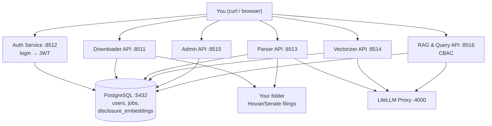

# Congressional Financial Disclosures Platform

[](https://www.python.org/)
[](https://www.docker.com/)
[](https://fastapi.tiangolo.com/)
[](https://www.postgresql.org/)
[](https://opensource.org/licenses/MIT)

An automated platform that **downloads**, **organizes**, **parses**, and
**vectorizes** official U.S. Congressional Financial Disclosures (STOCK Act
**Periodic Transaction Reports** and **Annual Reports**) for both the **House of
Representatives** and the **Senate**. Filings are stored **outside the
containers** on a folder of your choice, embeddings are stored in PostgreSQL with
**pgvector**, and the APIs are protected by a dedicated authentication service.

---

## Table of Contents

1. [What This Does](#what-this-does)
2. [New to Docker? Start Here](#new-to-docker-start-here)
3. [Quick Start (Copy & Paste)](#quick-start-copy--paste)
4. [What Just Happened? (Architecture)](#what-just-happened-architecture)
5. [Services & Ports](#services--ports)
6. [Roles & Authorization](#roles--authorization)
7. [Environment Variables Reference](#environment-variables-reference)
8. [Security](#security)
9. [Running Without Docker](#running-without-docker)
10. [Automated Testing](#automated-testing)
11. [Image Build & Manual Deployment](#image-build--manual-deployment)
12. [Troubleshooting](#troubleshooting)
13. [Public Data & Responsible Use](#public-data--responsible-use)
14. [License](#license)

---

## What This Does

- **Downloads** House and Senate financial disclosure filings (PDFs and HTML).
- **Stores** them on your own disk in a tidy folder structure.
- **Parses** them into clean, machine-readable JSON using an LLM.
- **Vectorizes** each disclosure item into semantic embeddings stored in
  PostgreSQL with **pgvector** for fast similarity search.
- **Protects** everything behind a login (JWT + roles).

It runs as a small set of **containers** (see below) that talk to each other.

---

## New to Docker? Start Here

**Docker** runs each part of this project in its own isolated "container" — a
lightweight, self-contained box that already has everything it needs. You do
**not** install Python, PostgreSQL, or anything else on your computer; Docker
handles all of that.

You only need **two commands** to run the whole platform:

| Command | What it does |
| :--- | :--- |
| `docker compose up -d` | Starts everything in the background. |
| `docker compose down` | Stops everything. |

That's the whole idea. The rest of this guide is just filling in a few settings
and running those commands.

> **Prerequisite:** Install **Docker Desktop** from
> [docker.com/products/docker-desktop](https://www.docker.com/products/docker-desktop/),
> open it once, and wait until the whale icon says it is running. Verify with
> `docker compose version`.

---

## Quick Start (Copy & Paste)

Follow these steps in order. Each block is safe to copy and paste as-is.

### Step 1 — Get the code

```bash
git clone https://github.com/surenther/congress-stock-analaysis-download.git
cd congress-stock-analaysis-download
```

### Step 2 — Create your settings file and generate the required secrets

The platform **refuses to start** until three secrets are set (this is a security
feature — it prevents weak defaults). This one command creates `.env` and fills
in strong random values for you:

```bash
cp .env.example .env
python3 - <<'PY'
import secrets, pathlib
p = pathlib.Path(".env")
t = p.read_text()
t = t.replace("POSTGRES_PASSWORD=", f"POSTGRES_PASSWORD={secrets.token_hex(16)}", 1)
t = t.replace("JWT_SECRET_KEY=",    f"JWT_SECRET_KEY={secrets.token_hex(32)}", 1)
t = t.replace("LITELLM_MASTER_KEY=", f"LITELLM_MASTER_KEY=sk-{secrets.token_hex(24)}", 1)
p.write_text(t)
print("Done — secrets written to .env")
PY
```

> **What are these?**
> - `POSTGRES_PASSWORD` — the database password.
> - `JWT_SECRET_KEY` — the key that signs login tokens (must be ≥ 32 characters).
> - `LITELLM_MASTER_KEY` — the key the parser uses to talk to the LLM gateway.
>
> Prefer to set them by hand? Open `.env` in any text editor and fill in the three
> blank values. Generate each with `openssl rand -hex 32`.

### Step 3 — (Optional) Add an LLM key so parsing works

Downloading works without this, but **parsing** needs an LLM. Get a key from
[openrouter.ai](https://openrouter.ai/) and add it to `.env`:

```bash
# In .env:
OPENROUTER_API_KEY=sk-or-...your-key...
```

### Step 4 — Start everything

```bash
docker compose up -d --build
```

The first run takes a few minutes (it builds the images). When it finishes, check
that all containers are healthy:

```bash
docker compose ps
```

You should see `congress-db`, `congress-auth-service`, `congress-downloader-api`,
`congress-litellm-proxy`, `congress-parser-service`,
`congress-vectorizer-service`, `congress-admin-service`, and
`congress-rag-service` running.

### Step 5 — Create your first user (an admin)

There is **no sign-up page** (by design). Create the first account directly in the
database. You will be prompted to type a password:

```bash
HASH=$(python3 -c "import bcrypt, getpass; \
  print(bcrypt.hashpw(getpass.getpass().encode(), bcrypt.gensalt(rounds=12)).decode())")

docker compose exec -T db psql -U congress -d congress_db -v username="admin" \
  -v password_hash="$HASH" -v roles='["admin"]' <<'SQL'
CREATE EXTENSION IF NOT EXISTS pgcrypto;
INSERT INTO users (id, username, hashed_password, roles, is_active, created_at)
VALUES (gen_random_uuid(), :'username', :'password_hash', :'roles'::jsonb, true, NOW())
ON CONFLICT (username) DO UPDATE
   SET hashed_password = EXCLUDED.hashed_password,
       roles           = EXCLUDED.roles,
       is_active       = TRUE;
SQL
```

> If you changed `POSTGRES_USER`/`POSTGRES_DB` in `.env`, adjust `-U`/`-d` above.
> To **rotate** a password later (or add a read-only `user` account), see
> [Auth Service README → Provisioning Users](./services/auth-service/README.md#provisioning-users-directly-in-postgresql).

### Step 6 — Log in and save your token

```bash
TOKEN=$(curl -s -X POST "http://localhost:8512/api/v1/auth/login" \
  -H "Content-Type: application/json" \
  -d '{"username": "admin", "password": "the-password-you-typed"}' \
  | python3 -c "import sys, json; print(json.load(sys.stdin)['access_token'])")

echo "$TOKEN"
```

### Step 7 — Download filings

```bash
curl -s -X POST "http://localhost:8511/api/v1/download/trigger" \
  -H "Authorization: Bearer $TOKEN" \
  -H "Content-Type: application/json" \
  -d '{"chamber": "house", "year": "2026", "max_downloads": 10}'
```

This returns a `job_id` immediately. Check progress with:

```bash
curl -s "http://localhost:8511/api/v1/download/status/<job_id>" \
  -H "Authorization: Bearer $TOKEN"
```

Files land in `./data/house_rep/2026/...` on your computer.

### Step 8 — Parse the filings into JSON

```bash
curl -s -X POST "http://localhost:8513/api/v1/parse/trigger" \
  -H "Authorization: Bearer $TOKEN" \
  -H "Content-Type: application/json" \
  -d '{}'
```

Parsed JSON is written to `./data/parsed_json/{doc_id}.json`.

### Step 9 — Vectorize the parsed JSON into pgvector

```bash
curl -s -X POST "http://localhost:8514/api/v1/vectorize/trigger-bulk" \
  -H "Authorization: Bearer $TOKEN" \
  -H "Content-Type: application/json" \
  -d '{"chamber": "all", "embedding_model": "openrouter-embed", "force": false}'
```

Embeddings are stored in the `disclosure_embeddings` table (PostgreSQL + pgvector).
This step needs the same provider key the parser uses — the default embedding
alias is `openrouter-embed`, so set `OPENROUTER_API_KEY` in `.env` (add
`OPENAI_API_KEY` only if you switch the alias to `text-embedding-3-small`).

### Step 10 — Query with RAG (chamber-scoped)

```bash
curl -s -X POST "http://localhost:8516/api/v1/rag/query" \
  -H "Authorization: Bearer $TOKEN" \
  -H "Content-Type: application/json" \
  -d '{
        "prompt": "Which House members bought tech stocks?",
        "top_k": 5,
        "filters": {"chamber": "House"}
      }'
```

The RAG service enforces **Chamber-Based Access Control (CBAC)**: a `user`
account may only query the chambers in its `allowed_chambers` grant. A
cross-chamber request returns `403 Forbidden` before any embedding or LLM call.
See the [RAG Service README](./services/rag/README.md) for details.

### Step 11 — Stop everything

```bash
docker compose down        # stop (keeps your data)
docker compose down -v     # stop AND delete the database volume
```

### Handy links while it's running

| What | URL |
| :--- | :--- |
| **Web UI** | http://localhost:3000 |
| Downloader API docs (Swagger) | http://localhost:8511/docs |
| Auth API docs (Swagger) | http://localhost:8512/docs |
| Parser API docs (Swagger) | http://localhost:8513/docs |
| Vectorizer API docs (Swagger) | http://localhost:8514/docs |
| Admin / Observability API docs (Swagger) | http://localhost:8515/docs |
| RAG & Query API docs (Swagger) | http://localhost:8516/docs |
| Analytics API docs (Swagger) | http://localhost:8517/docs |
| LiteLLM Proxy | http://localhost:4000 |

---

## What Just Happened? (Architecture)

The platform is made of eight cooperating containers:



- **Auth Service** — checks your password and hands out a signed **JWT** token.
- **Downloader Service** — fetches filings from the House/Senate portals.
- **Parser Service** — turns filings into structured JSON via an LLM.
- **Vectorizer Service** — turns parsed JSON into semantic embeddings (pgvector).
- **Admin Service** — read-only aggregator over all three job tables (admin-only).
- **RAG & Query Service** — chamber-scoped hybrid search and RAG synthesis over
  `disclosure_embeddings`, enforcing Chamber-Based Access Control (CBAC).
- **LiteLLM Proxy** — a single gateway that routes to whichever LLM you use.
- **PostgreSQL** — stores users, job status, and vector embeddings.

> **Optional:** In production you usually put a reverse proxy (e.g. SWAG/Nginx) in
> front to add HTTPS. It is **not** included here; configure it separately and
> point it at `auth-service:8512`, `congress-service:8511`,
> `parser-service:8513`, `vectorizer-service:8514`, `admin-service:8515`, and
> `rag-service:8516`.

---

## Services & Ports

| Service | Container | Port | Purpose |
| :--- | :--- | :--- | :--- |
| `db` | `congress-db` | `5432` *(internal only)* | PostgreSQL 16 + `pgvector`. |
| `auth-service` | `congress-auth-service` | `8512` | Login, mandatory TOTP 2FA, JWT + refresh tokens, user management. |
| `congress-service` | `congress-downloader-api` | `8511` | Download API with async jobs. |
| `parser-service` | `congress-parser-service` | `8513` | Extraction API (LLM → JSON). |
| `vectorizer-service` | `congress-vectorizer-service` | `8514` | Embedding API (JSON → pgvector). |
| `admin-service` | `congress-admin-service` | `8515` | Job aggregation, pipeline orchestration, cluster health (admin-only). |
| `rag-service` | `congress-rag-service` | `8516` | Chamber-scoped hybrid search + RAG synthesis (CBAC). |
| `analytics-service` | `congress-analytics-service` | `8517` | Chamber-scoped dashboard, data grid, exports, watchlists. |
| `web` | `congress-web` | `3000` | Next.js 14 UI (BFF proxy, dashboard, chat, admin). |
| `litellm-proxy` | `congress-litellm-proxy` | `4000` | Multi-provider LLM gateway. |

> **Note:** The database is **not** published to your host — it is reachable only
> on the internal Docker network. This is intentional (see [Security](#security)).

---

## Roles & Authorization

Authentication is centralized in the [Auth Service](./services/auth-service/README.md),
which issues signed JWTs. Every protected endpoint enforces a shared **two-tier
role model** via `require_role(...)` (see
[`auth_utils.py`](./services/auth-service/auth_utils.py:1)). Roles are stored as a
JSONB array on the `users` row and embedded in the JWT `roles` claim.

| Role | `allowed_chambers` | Description |
| :--- | :--- | :--- |
| `admin` | Always both chambers (RAG-side override) | Full access — trigger downloads, parsing, and vectorization; view status; fetch documents; read the cross-service observability API; and query both chambers in the RAG service. |
| `user` | Signed JWT claim (defaults to both) | Read-only — view job status and fetch parsed documents; query the RAG service within its `allowed_chambers` grant. |

| Endpoint | Required role |
| :--- | :--- |
| `POST /api/v1/download/trigger` | `admin` |
| `GET /api/v1/download/status/{job_id}` | `admin` or `user` |
| `GET /api/v1/download/status/{job_id}/items` | `admin` or `user` |
| `POST /api/v1/parse/trigger` | `admin` |
| `GET /api/v1/parse/status/{job_id}` | `admin` or `user` |
| `GET /api/v1/parse/status/{job_id}/items` | `admin` or `user` |
| `GET /api/v1/parse/document/{doc_id}` | `admin` or `user` |
| `POST /api/v1/vectorize/trigger` | `admin` |
| `POST /api/v1/vectorize/trigger-bulk` | `admin` |
| `GET /api/v1/vectorize/status/{job_id}` | `admin` or `user` |
| `GET /api/v1/vectorize/status/{job_id}/items` | `admin` or `user` |
| `GET /api/v1/vectorize/document/{doc_id}` | `admin` or `user` |
| `GET /api/v1/jobs` | `admin` |
| `GET /api/v1/jobs/summary` | `admin` |
| `GET /api/v1/jobs/{service}/{job_id}` | `admin` |
| `GET /api/v1/jobs/{service}/{job_id}/items` | `admin` |
| `POST /api/v1/rag/query` | `admin` or `user` (CBAC-scoped) |
| `POST /api/v1/rag/search-structured` | `admin` or `user` (CBAC-scoped) |
| `GET /api/v1/auth/me` | any authenticated user |

* Unauthenticated requests return `401`; authenticated requests lacking the
  required role return `403`.

Accounts are provisioned out-of-band (there is no public registration endpoint)
using [`services/auth-service/scripts/create_user.sql`](./services/auth-service/scripts/create_user.sql:1).
See [Step 5](#step-5--create-your-first-user-an-admin) for an example.

---

## How to Authenticate a User for a Particular Chamber

Chamber scoping is carried in the signed `allowed_chambers` JWT claim. The
[auth-service](./services/auth-service/README.md) issues the claim; the
[RAG service](./services/rag/README.md) enforces it. To authenticate a user for a
single chamber:

### 1. Provision the account with a chamber grant

```bash
# House-only user
docker compose exec -T db psql \
  -U "${POSTGRES_USER:-congress}" -d "${POSTGRES_DB:-congress_db}" \
  -v username='house_user' \
  -v password_hash='<paste the generated bcrypt hash>' \
  -v roles='["user"]' \
  -v allowed_chambers='["House"]' \
  -f services/auth-service/scripts/create_user.sql
```

Use `'["Senate"]'` for a Senate-only user, or `'["House", "Senate"]'` for both.
See [Provisioning Users Directly in PostgreSQL](./services/auth-service/README.md#provisioning-users-directly-in-postgresql)
for the password-hash steps.

### 2. Log in and confirm the claim

```bash
TOKEN=$(curl -s -X POST http://localhost:8512/api/v1/auth/login \
  -H "Content-Type: application/json" \
  -d '{"username":"house_user","password":"<password>"}' | jq -r .access_token)

curl -s http://localhost:8512/api/v1/auth/me \
  -H "Authorization: Bearer $TOKEN" | jq '.allowed_chambers'
# ["House"]
```

### 3. Query the RAG service

```bash
# In-scope chamber → 200
curl -s -X POST http://localhost:8516/api/v1/rag/query \
  -H "Authorization: Bearer $TOKEN" \
  -H "Content-Type: application/json" \
  -d '{"prompt":"Recent House tech trades","filters":{"chamber":"House"}}' | jq

# Out-of-scope chamber → 403 (CBAC guardrail)
curl -s -o /dev/null -w '%{http_code}\n' \
  -X POST http://localhost:8516/api/v1/rag/query \
  -H "Authorization: Bearer $TOKEN" \
  -H "Content-Type: application/json" \
  -d '{"prompt":"Recent Senate tech trades","filters":{"chamber":"Senate"}}'
# 403
```

### Admin accounts bypass the restriction

`admin` accounts are **not** chamber-restricted: the RAG service overrides the
claim to `["House", "Senate"]`, so an admin token can query either chamber. Only
`user` accounts are scoped by the claim.

### Changing a user's chamber grant

```sql
UPDATE users SET allowed_chambers = '["Senate"]'::jsonb WHERE username = 'house_user';
```

> Tokens already issued keep their original claim until they expire. To revoke
> access immediately, rotate the user's password or shorten
> `ACCESS_TOKEN_EXPIRE_MINUTES`.

---

## Environment Variables Reference

All runtime configuration is driven by environment variables. The root
[`.env.example`](.env.example) is the single template consumed by
`docker-compose.yml`; the downloader additionally reads chamber-specific files
([`.env.house.example`](services/downloader/.env.house.example) and
[`.env.senate.example`](services/downloader/.env.senate.example)).

### How variables reach the containers

1. Docker Compose automatically reads a file named **`.env`** next to
   `docker-compose.yml` (copy `.env.example` → `.env`).
2. Compose substitutes `${VAR}` / `${VAR:-default}` references in
   `docker-compose.yml` using those values.
3. The resolved values are injected into each container's environment, and the
   host storage path is bound via `${OUTPUT_BASE_DIR:-./data}:/data`.

### 1. Storage

| Variable | Default | Used by | Description |
| :--- | :--- | :--- | :--- |
| `OUTPUT_BASE_DIR` | `./data` (host) / `/data` (container) | `congress-service`, `parser-service`, `vectorizer-service` | Host folder where filings and parsed JSON are stored. The apps always read/write `/data` inside the container, which maps to this host folder. |

> **Permissions:** the containers run as a **non-root user (UID 10001)**, so the
> host folder must be writable by that UID. On Linux, run
> `sudo chown -R 10001:10001 ./data` if you see permission errors.

### 2. PostgreSQL (`pgvector/pgvector:pg16`)

| Variable | Default | Used by | Description |
| :--- | :--- | :--- | :--- |
| `POSTGRES_USER` | `congress` | all services | Database user name. |
| `POSTGRES_PASSWORD` | ***(required)*** | all services | Database password. **No default — Compose refuses to start until you set it.** |
| `POSTGRES_DB` | `congress_db` | all services | Database name. |
| `POSTGRES_PORT` | `5432` | `db` | Only used if you uncomment the `ports:` mapping in `docker-compose.yml` for local debugging. |
| `DATABASE_URL` | *(derived)* | `auth-service`, `congress-service`, `parser-service`, `vectorizer-service`, `admin-service`, `rag-service` | Full DSN, composed in `docker-compose.yml`. |

### 3. JWT Authentication (shared by all services)

| Variable | Default | Used by | Description |
| :--- | :--- | :--- | :--- |
| `JWT_SECRET_KEY` | ***(required)*** | all services | HMAC secret used to sign and verify JWTs. **Must be ≥ 32 characters and identical across all services.** No default. |
| `ACCESS_TOKEN_EXPIRE_MINUTES` | `30` | `auth-service` | Access-token lifetime in minutes. |

> The signing algorithm is **fixed to `HS256` in code** and is not configurable
> (this prevents algorithm-confusion attacks). Tokens also carry `iss`/`aud`
> claims that are validated on every request.

### 4. LLM Providers & LiteLLM Proxy (used by `parser-service`, `vectorizer-service`, and `rag-service`)

| Variable | Default | Used by | Description |
| :--- | :--- | :--- | :--- |
| `OPENROUTER_API_KEY` | *(empty)* | `litellm-proxy` | OpenRouter API key (default cloud provider). |
| `HUGGINGFACE_API_KEY` | *(empty)* | `litellm-proxy` | Hugging Face Inference API token. |
| `OPENAI_API_KEY` | *(empty)* | `litellm-proxy` | OpenAI API key — used by the vectorizer's optional `text-embedding-3-small` embedding alias. |
| `OLLAMA_API_BASE` | `http://host.docker.internal:11434` | `litellm-proxy` | Base URL of a self-hosted Ollama/vLLM server. |
| `LITELLM_MASTER_KEY` | ***(required)*** | `litellm-proxy`, `parser-service`, `vectorizer-service`, `rag-service` | Master key the parser/vectorizer/RAG services use to authenticate to the proxy. No default. |
| `LITELLM_DEFAULT_MODEL` | `openrouter-deepseek-flash` | `parser-service` | Default model alias when a job does not specify one. |
| `EMBEDDING_MODEL` | `openrouter-embed` | `vectorizer-service`, `rag-service` | Embedding model alias — shared so query and stored vectors always match. |
| `EMBEDDING_DIM` | `1536` | `vectorizer-service` | Expected vector dimension (must match the `vector(N)` column). |
| `EMBEDDING_BATCH_SIZE` | `64` | `vectorizer-service` | Chunks per embeddings request. |
| `RAG_DEFAULT_MODEL` | `openrouter-deepseek-flash` | `rag-service` | Default chat model alias for RAG synthesis. |
| `LITELLM_PORT` | `4000` | `litellm-proxy` | Host port mapped to the proxy's `4000`. |

### 5. Service ports

| Variable | Default | Used by | Description |
| :--- | :--- | :--- | :--- |
| `PORT` | `8511` | `congress-service` | Host port for the downloader API. |
| `AUTH_PORT` | `8512` | `auth-service` | Host port for the auth API. |
| `PARSER_PORT` | `8513` | `parser-service` | Host port for the parser API. |
| `VECTORIZER_PORT` | `8514` | `vectorizer-service` | Host port for the vectorizer API. |
| `ADMIN_PORT` | `8515` | `admin-service` | Host port for the admin/observability API. |
| `RAG_PORT` | `8516` | `rag-service` | Host port for the RAG & query API. |
| `LITELLM_PORT` | `4000` | `litellm-proxy` | Host port for the LiteLLM Proxy. |

### 6. Downloader pipeline variables (`.env.house` / `.env.senate`)

Read by the ingestion engine, not by Compose. See the
[Downloader Service README](./services/downloader/README.md#configuration-reference)
for the full table. Summary:

| Variable | Default | Description |
| :--- | :--- | :--- |
| `CHAMBER` | `House of Representatives` / `Senate` | Chamber name used in logs. |
| `YEAR` | `2026` | Filing year to target. |
| `OUTPUT_DIR` | `house_rep` / `senate` | Destination subfolder for this chamber. |
| `BASE_URL` | — | Portal base URL. |
| `PORTAL_URL` | — | Human-facing portal URL. |
| `AGREEMENT_URL` | — | *(Senate)* Statutory agreement gate URL. |
| `SEARCH_URL` | `{base_url}/search/` | *(Senate)* Search page URL. |
| `SEARCH_DATA_URL` | — | *(Senate)* DataTables JSON endpoint. |
| `AUTO_ACCEPT_AGREEMENT` | `false` | *(Senate)* Auto-submit the prohibitions checkbox. |
| `SENATE_REPORT_TYPES` | `annual,periodic` | *(Senate)* Report types to query. |
| `START_DATE` | `01/01/{year}` | *(Senate)* Date-filed range start. |
| `END_DATE` | `TODAY` | *(Senate)* Date-filed range end. |
| `ZIP_URL_TEMPLATES` | — | *(House)* Comma-separated bulk ZIP URL templates. |
| `ZIP_FILENAME_TEMPLATE` | `{year}FD.zip` | *(House)* Local ZIP filename template. |
| `PTR_PDF_URL_TEMPLATE` | — | *(House)* PTR PDF URL template. |
| `FINANCIAL_PDF_URL_TEMPLATE` | — | *(House)* Annual/financial PDF URL template. |
| `FILING_TYPES` | `ALL` | Filing-type filter (`P,A,O,C,T,Z` or `ALL`). |
| `REP_NAME_FORMAT` | `last_first` | `last_first` (`Pelosi_Nancy`) or `first_last`. |
| `MONTH_FORMAT` | `01_January` | `01_January`, `January`, `01`, or `Jan`. |
| `REQUEST_DELAY` | `0.3` | Seconds between PDF downloads. |
| `MAX_DOWNLOADS` | `0` | Max files to download (`0` = all). |
| `FORCE_DOWNLOAD` | `false` | Overwrite existing local files. |
| `USER_AGENT` | Chrome UA string | HTTP `User-Agent` header. |

### 7. Logging

| Variable | Default | Used by | Description |
| :--- | :--- | :--- | :--- |
| `LOG_LEVEL` | `INFO` | all services | Log verbosity (`DEBUG`, `INFO`, `WARNING`, `ERROR`). View logs with `docker compose logs -f <container>`. |

### 8. Container registry

| Variable | Default | Used by | Description |
| :--- | :--- | :--- | :--- |
| `IMAGE_REGISTRY` | `docker.io/congress` | `docker-compose.yml`, Gitea build workflow | Registry host plus optional namespace used to name/pull the built images. |

---

## Security

This project was hardened following a security audit. The key protections:

- **No default secrets.** The services **refuse to start** unless
  `JWT_SECRET_KEY` (≥ 32 chars), `POSTGRES_PASSWORD`, and `LITELLM_MASTER_KEY`
  are set to strong values. There are no `change-me` fallbacks.
- **Fixed JWT algorithm.** Signing is hardcoded to `HS256`; tokens carry and
  validate `iss`/`aud`/`exp`/`sub` claims.
- **Database is not exposed.** The Postgres port is not published to the host.
- **Non-root containers.** All images run as UID **10001**.
- **Least-privilege file access.** The parser and vectorizer only read files
  **inside** `/data` (absolute paths and `..` traversal are rejected).
- **SSRF protection.** The downloader only fetches URLs on the configured
  House/Senate host.
- **Login rate limiting.** Repeated failed logins are throttled (HTTP `429`).
- **No user enumeration.** Unknown, inactive, and wrong-password logins all
  return the same generic `401`.
- **Hardened XML parsing** (`defusedxml`) and **security headers** on every
  response.
- **Pinned dependencies and CI actions** for reproducible, tamper-resistant
  builds.

> **Reporting a vulnerability:** please open a private security advisory or email
> the maintainers rather than filing a public issue.

---

## Running Without Docker

You can run the ingestion engine directly with Python 3.10+:

```bash
cd services/downloader
python3 -m venv .venv
source .venv/bin/activate
pip install -r requirements.txt

# House ingestion (loads .env.house)
python3 download_filings.py house
# Senate ingestion (loads .env.senate)
python3 download_filings.py senate
# Limit to 10 downloads for a quick test
MAX_DOWNLOADS=10 python3 download_filings.py house
```

For the auth service, see the
[Auth Service README](./services/auth-service/README.md#running-the-service-standalone).
For the parser and vectorizer services, see their
[Parser Service README](./services/parser/README.md#running-the-service-standalone)
and
[Vectorizer Service README](./services/vectorizer/README.md#running-the-service-standalone).
For the RAG & query service, see the
[RAG Service README](./services/rag/README.md#running-the-service-standalone).

---

## Automated Testing

An automated HTTP test suite lives in [`tests/`](./tests/README.md) and covers
**every service** — auth, downloader, parser, vectorizer, admin, and RAG — plus
cross-cutting concerns (security headers, the RBAC matrix, 401 vs 403, request
validation, 404s, and the 409 concurrency guard).

### Quick start

```bash
# 1. Paste your credentials into a git-ignored file
cp tests/.env.test.example tests/.env.test
#    ...edit tests/.env.test (base URLs + admin/user/house/senate logins)...

# 2. Start the stack (normal or isolated test stack)
docker compose up -d
#    or: docker compose -f docker-compose.test.yml up -d --build

# 3. Install test dependencies
python -m venv .venv && source .venv/bin/activate
pip install -r tests/requirements-test.txt

# 4. Run the fast contract/negative suite (no LLM spend)
pytest tests -m "not llm and not slow"

# 5. Run the full integration suite (spends LLM credits)
RUN_LLM_TESTS=true pytest tests -m "llm" --maxfail=1
```

### Two run modes

| Mode | Command | LLM spend |
| :--- | :--- | :--- |
| **Contract / negative** (default) | `pytest tests -m "not llm and not slow"` | None |
| **Full integration** | `RUN_LLM_TESTS=true pytest tests -m "llm"` | Yes |

### Isolated test stack

[`docker-compose.test.yml`](./docker-compose.test.yml) runs the same images with a
**separate database** (`congress_test_db`), a **separate volume** (`pgdata_test`),
and **shifted host ports** (`+100`), so it can run alongside the normal stack
without touching production data. Point `tests/.env.test` at the shifted ports
(`8611`–`8616`) when using it.

See the [test suite README](./tests/README.md) for the full guide, including how
to provision the test users referenced in `tests/.env.test`.

---

## Image Build & Manual Deployment

Images are **built and pushed automatically** to a container registry by the
Gitea Actions workflow ([`.gitea/workflows/deploy.yml`](.gitea/workflows/deploy.yml))
on every push to `main` (or a `v*` tag). The workflow **does not deploy** —
deployment is performed **manually on the server** by pulling the images.

### Choosing a registry

Set the `IMAGE_REGISTRY` variable (registry host plus optional namespace) in two
places:

- **Gitea** (for the build workflow): Repository → Settings → Actions →
  Variables → add `IMAGE_REGISTRY` (e.g. `registry.example.com`,
  `docker.io/myuser`, or `ghcr.io/myorg`). If unset, it falls back to
  `docker.io/congress`.
- **Server `.env`** (for `docker-compose.yml`): set `IMAGE_REGISTRY` to the same
  value so Compose pulls the right images.

### What the workflow builds

The workflow builds and pushes the downloader, auth, parser, vectorizer, admin,
and RAG images.

| Image | Source |
| :--- | :--- |
| `${IMAGE_REGISTRY}/congress-downloader` | `services/downloader` |
| `${IMAGE_REGISTRY}/congress-auth` | `services/auth-service` |
| `${IMAGE_REGISTRY}/congress-parser` | `services/parser` |
| `${IMAGE_REGISTRY}/congress-vectorizer` | `services/vectorizer` |
| `${IMAGE_REGISTRY}/congress-admin` | `services/admin-service` |
| `${IMAGE_REGISTRY}/congress-rag` | `services/rag` |

Each image is tagged with `latest` and the short commit SHA (or the tag name).
The runner must already be authenticated to the registry.

### Server setup (one-time)

1. Create the deploy directory and enter it:
   ```bash
   mkdir -p /opt/congress-stock-analysis
   cd /opt/congress-stock-analysis
   ```
2. Create the directory layout the compose file expects:
   ```bash
   mkdir -p services/downloader services/parser services/vectorizer services/admin-service services/rag
   ```
3. Create the root `.env` (from `.env.example`) and set your values — in
   particular `OUTPUT_BASE_DIR` and the three required secrets:
   ```bash
   cp .env.example .env
   nano .env
   ```
4. Create the downloader chamber env files (from the templates):
   ```bash
   cp services/downloader/.env.house.example services/downloader/.env.house
   cp services/downloader/.env.senate.example services/downloader/.env.senate
   ```
   > **Important:** inside the container, `OUTPUT_BASE_DIR` must be `/data` (the
   > mounted volume path). Do **not** change it to a host path in these files.

### Deploying an update

```bash
cd /opt/congress-stock-analysis
docker compose pull           # pull the freshly pushed registry images
docker compose up -d          # recreate containers with the new images
docker compose ps
```

If you also changed `docker-compose.yml` or the LiteLLM config, copy those first
(adjust host/path):

```bash
scp docker-compose.yml user@server:/opt/congress-stock-analysis/docker-compose.yml
scp services/parser/litellm_config.yaml \
    user@server:/opt/congress-stock-analysis/services/parser/litellm_config.yaml
```

To build locally instead of pulling, use `docker compose up -d --build`.

> **Note:** The `litellm-proxy` service uses a **pinned** public image
> (`ghcr.io/berriai/litellm:v1.110.2`) and mounts
> `services/parser/litellm_config.yaml` read-only, so updating that file and
> recreating the container (`docker compose up -d --force-recreate litellm-proxy`)
> is enough to change model routing.

### Verifying a deploy

```bash
curl -s http://localhost:8512/health   # auth
curl -s http://localhost:8511/health   # downloader
curl -s http://localhost:8513/health   # parser
curl -s http://localhost:8514/health   # vectorizer
curl -s http://localhost:8515/health   # admin
curl -s http://localhost:8516/health   # rag
curl -s http://localhost:4000/health/liveliness   # litellm proxy
docker compose logs -f congress-parser-service
docker compose logs -f congress-vectorizer-service
docker compose logs -f congress-rag-service
```

---

## Troubleshooting

| Symptom | Likely cause | Fix |
| :--- | :--- | :--- |
| `docker compose up` fails with `POSTGRES_PASSWORD must be set` (or `JWT_SECRET_KEY` / `LITELLM_MASTER_KEY`) | A required secret is missing. | Run [Step 2](#step-2--create-your-settings-file-and-generate-the-required-secrets) to fill `.env`. |
| A service exits at startup with `JWT_SECRET_KEY is unset, shorter than 32 characters...` | The JWT secret is missing or too short. | Set a ≥ 32-character `JWT_SECRET_KEY` in `.env`. |
| `permission denied` writing to `./data` | The host folder is not writable by UID 10001. | `sudo chown -R 10001:10001 ./data` (Linux). |
| `401 Invalid credentials` on login | No matching user, or wrong password. | Confirm the row exists (`SELECT username FROM users;`) and the password matches. |
| `429 Too many login attempts` | Login rate limit hit. | Wait a few minutes and try again. |
| `403 Insufficient permissions` | Token lacks the required role. | Provision the user with `admin` (write) or `user` (read). |
| Tokens rejected by the downloader/parser/vectorizer | `JWT_SECRET_KEY` mismatch between services. | Set the same `JWT_SECRET_KEY` for all services (Compose does this via `.env`). |
| Parser job `FAILED` with a proxy error | LiteLLM Proxy unreachable or missing provider key. | Check `docker compose logs congress-litellm-proxy`; set `OPENROUTER_API_KEY`. |
| Vectorizer job `FAILED` with a proxy error | LiteLLM Proxy unreachable or no embedding model configured. | Check `docker compose logs congress-litellm-proxy`; verify the embedding alias in `services/parser/litellm_config.yaml` and `OPENROUTER_API_KEY`. |
| RAG query returns `403 Access Denied...` | CBAC guardrail tripped (cross-chamber request). | Expected for a `user` token querying an out-of-scope chamber; use an in-scope chamber or an `admin` token. |
| RAG query returns `500` | LiteLLM Proxy unreachable or embedding-model mismatch. | Check `docker compose logs congress-litellm-proxy`; ensure `EMBEDDING_MODEL` is set to the model used to populate `disclosure_embeddings`. |
| RAG `sources` empty | No rows in `disclosure_embeddings` for the requested chamber. | Run the vectorizer first (Step 9) and confirm the chamber has data. |
| Files not appearing on the host | Volume not mounted / wrong `OUTPUT_BASE_DIR`. | Confirm `OUTPUT_BASE_DIR` in `.env` and that the container writes to `/data`. |
| Tests fail with `httpx.ConnectError` | The stack is not running, or `tests/.env.test` points at the wrong ports. | Start the stack (`docker compose up -d`) and check the base URLs in `tests/.env.test`. |
| Tests are all **skipped** | No credentials configured. | Paste the `TEST_*_USERNAME/PASSWORD` pairs (or `JWT_SECRET_KEY`) into `tests/.env.test`. |
| Tests fail with `429 Too many login attempts` | The auth login rate limit was hit. | Wait ~5 minutes; the suite caches tokens to avoid this. See the [test suite README](./tests/README.md). |
| Integration tests skipped | `RUN_LLM_TESTS` is false. | Set `RUN_LLM_TESTS=true` in `tests/.env.test` (spends LLM credits). |

---

## Public Data & Responsible Use

This tool accesses publicly accessible records provided by congressional
disclosure portals. Users are responsible for ensuring their use complies with
public record guidelines, which state that disclosure data is provided for public
transparency and news reporting, and should not be used for commercial
solicitation, credit assessments, or unauthorized purposes.

---

## License

This project is licensed under the MIT License — see the [LICENSE](LICENSE) file for details.
