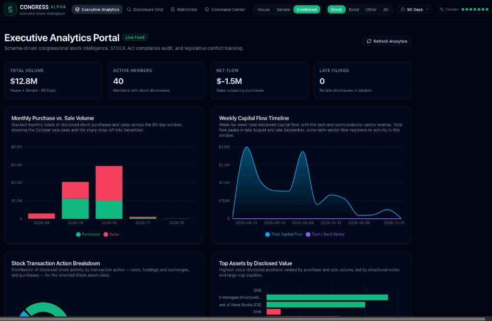
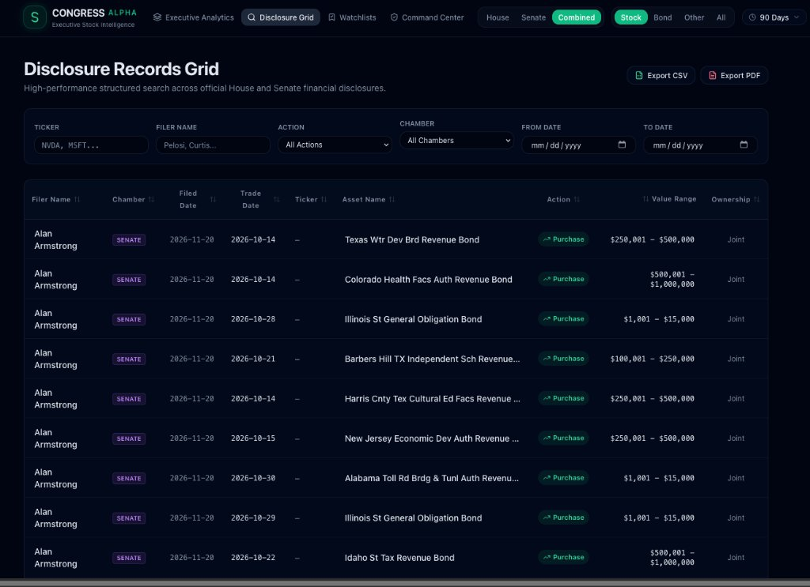
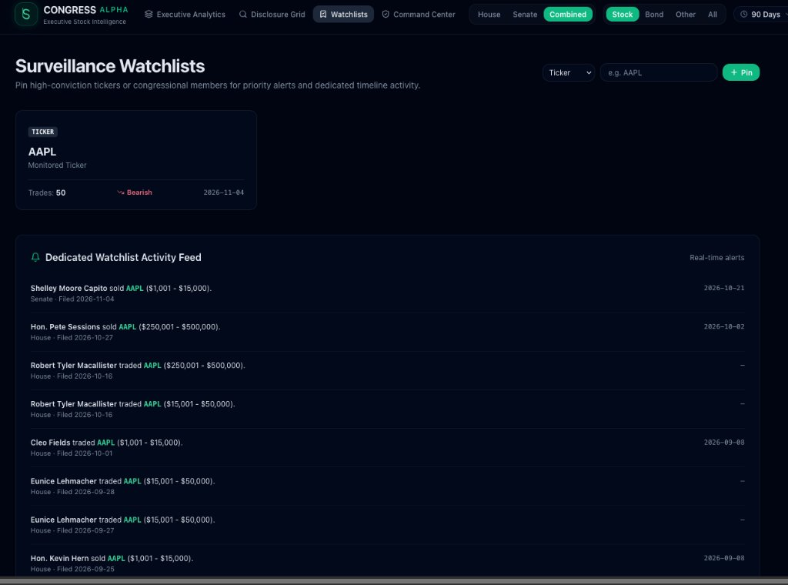
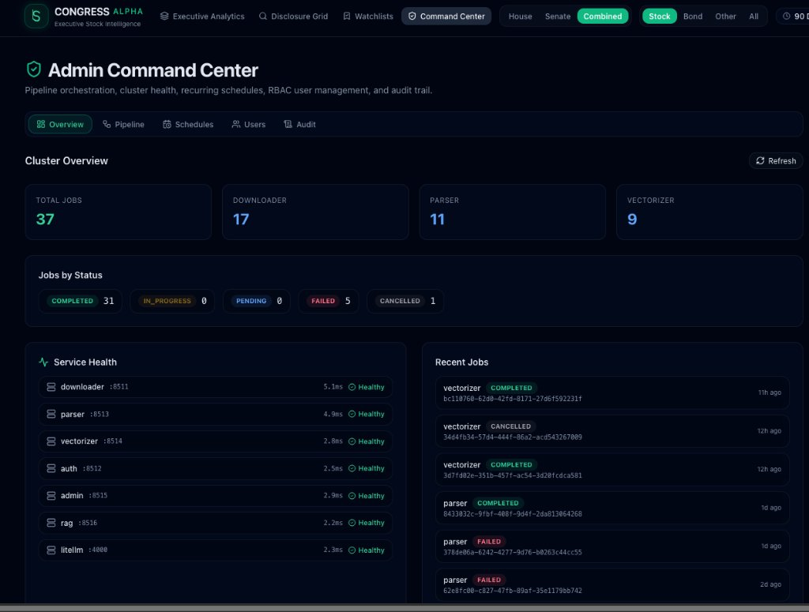
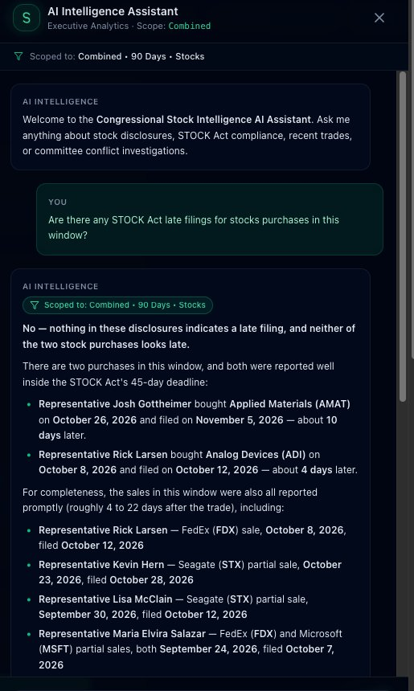

# Web UI & Executive Analytics Portal (`services/web`)

[](https://nextjs.org/)
[](https://www.typescriptlang.org/)
[](https://tailwindcss.com/)
[](https://github.com/surenther/congress-stock-analaysis-download)
[](https://github.com/surenther/congress-stock-analaysis-download)
[](https://www.docker.com/)

The **Web UI & Executive Analytics Portal** is the user-facing interface for the Congressional Stock Disclosures platform. Built with **Next.js 14 (App Router)** and **TypeScript**, it features a financial dashboard design language inspired by Meridian Financial Analytics, generative schema-driven UI widgets, Chamber-Based Access Control (CBAC), and an AI RAG Assistant with citation inspection.

> [!NOTE]
> **Educational & Engineering Purpose:** This web portal is built strictly for educational research and software experimentation with modern LLMs and agentic application architectures. It is **not financial advice** and does not provide investment trading signals.

---

## UI Visual Tour

| Executive Analytics (`/dashboard`) | Disclosure Records Grid (`/search`) |
| :---: | :---: |
|  |  |
| *Macro KPI metrics, stacked volume bars, capital flow timelines* | *Multi-facet filter grid with one-click CSV and PDF exports* |

| Surveillance Watchlists (`/watchlists`) | Admin Command Center (`/admin`) |
| :---: | :---: |
|  |  |
| *Pinned high-conviction tickers & live activity feed* | *Cluster health, pipeline triggers, recurring schedules & RBAC* |

<p align="center">
  
  <br />
  <em>AI Intelligence Assistant Drawer with Chamber-Scoped Retrieval & Transparent Citations</em>
</p>

---

## Port & Container

| Service | Container Name | Port | Base URL |
| :--- | :--- | :--- | :--- |
| `web-service` | `congress-web` | **3000** | `http://localhost:3000` |

---

## Key Features

1. **Schema-Driven UI Engine:**
   - React components act as pure presentation templates.
   - Layout, calculations, and widget configuration are evaluated by the backend RAG/Analytics engine (`POST /api/v1/rag/dashboard/analytics`).
   - Central [`WidgetRenderer`](components/dashboard/WidgetRenderer.tsx) mounts visual templates:
     - `<MetricCardWidget/>`: Upper-case category, big KPI number, trend pill badge with direction arrow.
     - `<BarChartWidget/>`: Recharts stacked/grouped bar chart (Purchases vs. Sales).
     - `<LineChartWidget/>`: Smooth curve area chart for volume timelines and trade momentum.
     - `<PieChartWidget/>`: Donut chart with inline percentage legend for sector distribution.
     - `<DataTableWidget/>`: Sortable grid with fallback badges for null cells (`—`).

2. **Executive Header & CBAC Chamber Scope:**
   - **Chamber Scope Tabs:** `House` | `Senate` | `Combined`.
   - **CBAC Lock:** Detects user's signed `allowed_chambers` JWT claim. If restricted to a single chamber (e.g. `["House"]`), the selector is locked with a lock icon tooltip.
   - **Time Horizon:** `30 Days`, `90 Days`, `YTD`, `1 Year`, `All Time`.
   - **Cluster Health Status:** Live green/red status dots monitoring backend microservices (`:8511`, `:8512`, `:8513`, `:8514`, `:8516`, `:4000`).
   - **User Scope Pill:** Displays active username, role badge (`admin` / `user`), and quick role-switch demo options.

3. **High-Performance Disclosure Records Grid (`/search`):**
   - Filter by Ticker, Filer Name, Action (`Purchase`, `Sale`, `Exchange`), Chamber, and Date Range.
   - Prominently displays `asset_name` when `ticker` is blank or unlisted (`—`).
   - One-click **CSV** and **PDF** export.

4. **Surveillance Watchlists (`/watchlists`):**
   - Pin high-conviction tickers (`NVDA`, `MSFT`) or members (`Nancy Pelosi`).
   - Dedicated activity timeline with live trade alerts and sentiment flags.

5. **Admin Command Center (`/admin`):**
   - Restricted strictly to accounts with the `admin` role.
   - Tabbed console: **Overview**, **Pipeline**, **Schedules**, **Users**, and **Audit**.
   - **Overview** — job-count tiles by service/status, live cluster health, and recent jobs.
   - **Pipeline** — manual triggers (Chamber / Limit / Force) for Downloader (`:8511`), Parser (`:8513`), and Vectorizer (`:8514`); a filterable job table with a per-document detail drawer, **Retry Failed**, and **Cancel** (cooperative cancellation).
   - **Schedules** — create/list/delete recurring pipeline schedules.
   - **Users** — RBAC table with create-user modal, password reset, 2FA reset, activate/deactivate, and multi-select **bulk actions** (activate, deactivate, reset-2FA, grant chambers).
   - **Audit** — filterable audit-log viewer (action, actor, target type, date range).

6. **Slide-Out AI Assistant (`ChatDrawer`):**
   - Floating bottom-right action button accessible across all views.
   - Queries `POST /api/v1/rag/query` with CBAC guardrails.
   - Expandable **Source Citation Cards** detailing Filer Name, Chamber, Ticker, Asset Name, Trade Date, Value Range, Similarity Score %, and Doc ID.
   - Instant visual toast if access is restricted by CBAC policy (`403 Forbidden`).

---

## Directory Structure

```text
services/web/
├── app/
│   ├── layout.tsx                     # Root layout with Header, Footer, and ChatDrawer
│   ├── globals.css                    # Tailwind design tokens and custom scrollbars
│   ├── page.tsx                       # Redirects to /dashboard
│   ├── dashboard/page.tsx             # Executive analytics dashboard
│   ├── search/page.tsx                # Disclosure records grid & export
│   ├── watchlists/page.tsx            # Pinned surveillance watchlists
│   ├── admin/page.tsx                 # Pipeline command center & user admin
│   └── api/                           # Next.js BFF route handlers
│       ├── health/                    # Container and cluster health probes
│       ├── disclosures/               # Search grid and CSV/PDF export endpoints
│       └── rag/                       # Dashboard schema and RAG query proxy
├── components/
│   ├── dashboard/                     # Pure presentation widget templates
│   │   ├── MetricCardWidget.tsx       # KPI cards with trend pill badges
│   │   ├── BarChartWidget.tsx         # Stacked/grouped bar charts
│   │   ├── LineChartWidget.tsx        # Trend velocity area curves
│   │   ├── PieChartWidget.tsx         # Asset sector donut chart
│   │   ├── DataTableWidget.tsx        # Sortable tables with null cell fallbacks
│   │   └── WidgetRenderer.tsx         # Dynamic schema layout renderer
│   ├── layout/                        # Header, Footer, and navigation
│   └── chat/                          # Slide-out AI RAG Assistant drawer
├── lib/
│   ├── auth-context.tsx               # Client-side auth, CBAC lock detection, and scope state
│   ├── query-provider.tsx             # TanStack React Query provider
│   └── utils.ts                       # Tailwind merge and currency/date formatters
├── types/                             # TypeScript schemas, disclosures, and auth models
├── Dockerfile                         # Node 20 Alpine multi-stage production build
└── package.json                       # Dependencies and build scripts
```

---

## Running Locally

### Option A: Via Docker Compose (Recommended)

From the project root:
```bash
docker compose up -d web-service
```
Open [http://localhost:3000](http://localhost:3000) in your browser.

### Option B: Standalone Development

Inside `services/web/`:
```bash
# 1. Install dependencies
npm install

# 2. Start development server
npm run dev
```
Open [http://localhost:3000](http://localhost:3000).

### Build & Verify Production Bundle

```bash
npm run build
```
Confirms clean TypeScript compilation and creates standalone static and server assets.

---

## Environment Variables

| Variable | Default | Description |
| :--- | :--- | :--- |
| `PORT` | `3000` | Port for the Next.js server. |
| `NODE_ENV` | `production` | Node environment (`development` or `production`). |
| `RAG_SERVICE_URL` | `http://localhost:8516` | URL for the RAG & Dashboard layout microservice. |
| `AUTH_SERVICE_URL` | `http://localhost:8512` | URL for the Auth microservice. |
| `ADMIN_SERVICE_URL` | `http://localhost:8515` | URL for the Admin orchestration microservice. |
| `SESSION_SECRET` | *(required in prod)* | Secret string for session cookies. |

---

## Known Security Advisories (Accepted Risk)

> **Status:** Tracked / Accepted Risk — reviewed 2026-11-25.
> **Decision:** Dependencies are intentionally left pinned. The only available
> remediations are **breaking major upgrades** that would jeopardize App Router
> compatibility, so they are deferred to a dedicated migration task rather than
> applied opportunistically.

`npm audit` reports 3 advisories (1 critical, 2 high). None can be resolved by a
patch-level `npm audit fix`; every fix path requires a major version jump.

| Package | Installed | Severity | Fix Requires | Notes |
| :--- | :--- | :--- | :--- | :--- |
| `next` | `14.2.x` | **Critical** | `next@16.4.6` (major) | Broad set of advisories affecting `<=16.3.0-preview.10`: Image Optimizer DoS/RCE (AVIF/SVG), RSC deserialization DoS, request smuggling in rewrites, middleware/proxy cache poisoning & i18n bypass, XSS in App Router CSP nonces and `beforeInteractive` scripts, SSRF in rewrites/Server Actions, and unauthenticated disclosure of Server Function endpoints. |
| `postcss` | `<=8.5.22` | **High** | `next@16.4.6` (transitive) | XSS via unescaped `</style>` in stringify output; arbitrary `.map` file read / path traversal via attacker-controlled `sourceMappingURL`. Pulled in transitively through `next`. |
| `zod` | `3.23.x` | **High** | `zod@4.6.7` (major) | Memory exhaustion while validating oversized constrained collections. |

### Why this is accepted (for now)

- **No patched 14.x line exists.** The `next` advisory range covers all `14.x`
  releases, so staying on Next 14 cannot be made safe by a patch bump.
- **Major upgrades are breaking.** `next@16` and `zod@4` are both major releases
  with API/behavior changes; applying them requires a coordinated migration and
  full regression testing of the App Router routes, BFF handlers, and forms.
- **`npm audit fix --force` was deliberately not run**, as it would silently
  install `next@16.4.6` and `zod@4.6.7` and break the build.

### Compensating controls currently in place

- The web container runs as a **non-root** user (`nextjs`, uid 1001) with a
  multi-stage build and a container `HEALTHCHECK` (see [`Dockerfile`](Dockerfile)).
- `poweredByHeader` is disabled and `reactStrictMode` is enabled
  (see [`next.config.mjs`](next.config.mjs)).
- The Next.js image optimizer is not exposed to untrusted remote patterns, and
  the app is deployed behind the platform's reverse proxy / network boundary.

### Follow-up (tracked)

- [ ] Plan and execute the **Next.js 16** migration (App Router, BFF routes,
      `next.config.mjs` rewrites) and re-run `npm run build`.
- [ ] Upgrade **Zod 3 → 4** and update all schema/validation call sites.
- [ ] Re-run `npm audit` after the migration and confirm 0 advisories.
